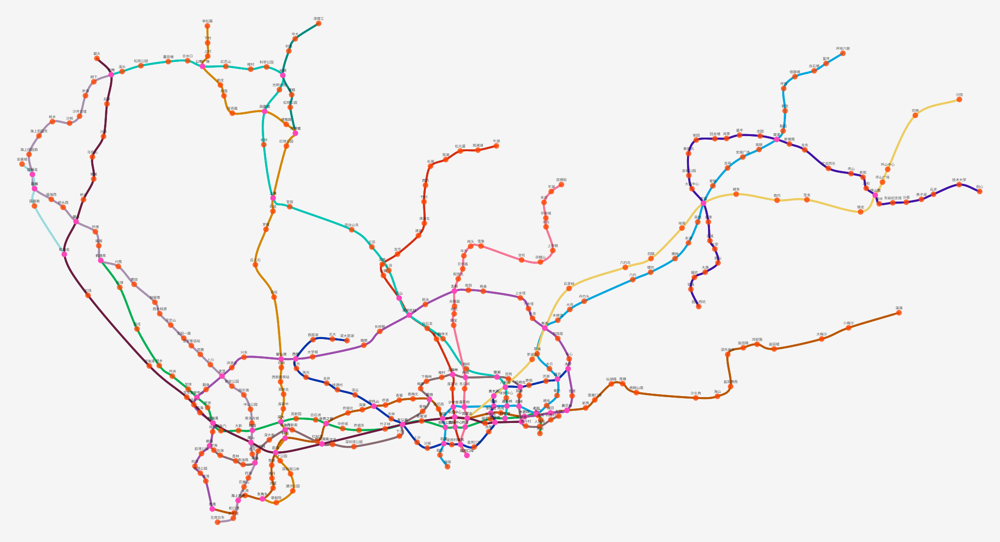
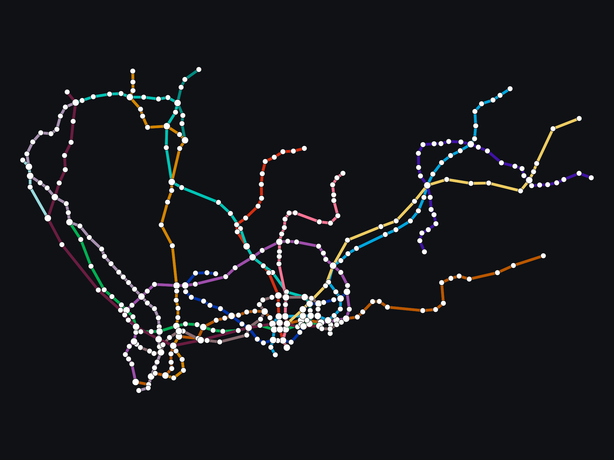

# MetroLang 语言

MetroLang 是一门描述地铁线网的**数据语言**，配有把线路数据编译成 JSON、反编译回 MetroLang、渲染自包含 HTML/SVG 地图并查询最短时间路径的完整工具链。

前端由本仓库的 `metrolang.gram` 经 [ParseEngine](https://gitee.com/rabbitc999/ParseEngine)
文法生成器产出，产物是一个可执行文件 `metro-lang`。

> 本工程是**独立仓库** <https://gitee.com/rabbitc999/metro-lang>（早期在 ParseEngine 仓库里
> 长大，现与 Magel、Hydra86、RustView、CAS 同例拆出）。生成器 ParseEngine 是外部依赖：
> 本仓库只含 `.gram`，构建时自动找旁边的 ParseEngine 仓库（见下）。

## 构建与运行

在项目根目录执行：

```sh
sh gen.sh                 # 用 ParseEngine 从 metrolang.gram 重新生成分析器（需要生成器，见下）
make                      # 固化模板 + 编译出 build/metro-lang/metro-lang
sh check.sh               # 样例冒烟：编译 → JSON → 反编译 → HTML → 路线
```

`gen.sh` / `make` 需要一份 **ParseEngine 文法生成器**（本项目只含 `.gram`，生成器是
外部依赖）。最省事是把它放到项目根目录 `./ParseEngine[.exe]`；也可以让它待在旁边的
ParseEngine 仓库里（脚本会自动找 `../ParseEngine/build/bin/`）。

中间产物都在本仓库的 `build/`（`build/metro-lang/gen/` 生成代码、`obj/` 目标文件、
`build/metro-lang/metro-lang` 可执行文件）。

```text
build/metro-lang/metro-lang check     文件.m
build/metro-lang/metro-lang compile   文件.m -o out.json
build/metro-lang/metro-lang decompile out.json -o out.metro
build/metro-lang/metro-lang html      文件.m -o out.html
build/metro-lang/metro-lang route     文件.m --from 站A --to 站B
```

更多 make 目标：`make gen` 只重新生成分析器与模板头；`make svg` 导出
`doc/shenzhen-metro.svg`；`make preview` 导出 `map_view/preview.svg`；
`make clean` 清掉 `build/`。发布门禁是 `sh ci.sh`。

## 目录

| 路径 | 内容 |
|---|---|
| `metrolang.gram` | **权威文法**：169 个关键字各占一个 `%token`，块/语句/参数/列表都有产生式 |
| `epilogue/metro_parse.cpp` | 语义层：块栈、逐行折叠、`compileText`，用 `%epilogue include` 内嵌进生成产物 |
| `include/metro_model.hpp` | 数据模型与公开 API（`Program` / `Line` / `Direction` / `Station` …） |
| `include/metro_semantics.hpp` | 文法动作调用的 `mb_*` 接口 |
| `src/compile.cpp` | 预处理接入 + `%IMPORT` CSV → `STATION_DEFINE` |
| `src/json.cpp` | 模型 ↔ JSON（对齐 `doc/02-json-format.md`） |
| `src/decompile.cpp` | **模板化**反编译：模型 → `tmpl::Value` → `template/templates/*.tmpl` |
| `src/html.cpp` | 自包含 SVG HTML 地图 |
| `src/route.cpp` | 站点/线路图上的 Dijkstra，权重取 `segmentRunTimeSeconds` |
| `gen.sh` / `Makefile` / `check.sh` / `ci.sh` | 生成、构建、样例冒烟与发布门禁 |
| `template/templates/*.tmpl` | 反编译模板；构建期由 `tools/embed_templates.py` 内嵌成 C++ 源 |
| `preprocess/` `template/` `json/` | 从 ParseEngine 的 `library/` 拷贝的依赖副本（各自独立） |
| `samples/` | `smoke.metro` / `demo.metro` 与真实城市样例（`beijing.m` / `shanghai.m` / `guangzhou.m` / `shenzhen.m` / `hefei.m` / `nanjing.m` + `TRANSFER.m` + CSV） |
| `doc/01-metrolang-reference.md` | 语言参考 |
| `doc/02-json-format.md` | JSON 数据格式（**v2**：站点是数组、无障碍设施内联在站点里、编组/链接是数组）与 HTML/SVG 地图输出 |
| `doc/03-travel-time-model.md` | 区间/出行时间模型 |
| `tools/embed_templates.py` | 把 `template/templates/*.tmpl` 固化成 C++ 头（构建期调用） |
| `tools/export_svg.py` | 从 `html` 输出里抽出独立 SVG（默认去站名、放大内联尺寸） |
| `doc/shenzhen-metro.svg` | README 里那张深圳线网图（`make svg` 生成） |
| `map_view/` | **交互式查看器**：可载入 metro-lang JSON 或编辑器 JSON，可配解释器位置 |
| `tests/metro_roundtrip.py` | 真实城市样例 `compile → decompile → compile` 幂等回归 |
| `vscode/` | **VS Code 插件**：`.metro` / `.m` 语法高亮 + 块折叠，命令打开语言参考 |

编辑器插件见 [`vscode/README.md`](vscode/README.md)：认 `.metro` / `.m`，给出 MetroLang
语法高亮与块折叠（`*_DEFINE` / `TRANSFER_TYPE` / `POLICY` / `ATTRIBUTES` 折到对应的
`END_*`），命令面板里的「Metro: 打开 MetroLang 语言参考」直接打开
[`doc/01-metrolang-reference.md`](doc/01-metrolang-reference.md)。

## 线网图

**交互式查看器**（`map_view/`，可缩放、悬停看站点信息、点图例筛选线路）：



查看器既能载入 `metro-lang compile` 写出的 JSON，也能载入编辑器的旧格式 JSON，还能在
界面上指定 metro-lang 解释器的位置。用法见 [`map_view/README.md`](map_view/README.md)。

**静态线网图**（`make svg`，给文档/README 用的矢量图）：



上图由 `metro-lang html` 渲染、`tools/export_svg.py` 抽出独立 SVG（`make svg` 重现）。
这是一张**纯线网图**：只画线路、换乘站（大圆点）与带无障碍设施的车站（绿色描边），
**不打印站名**——354 座车站的站名挤在一张图里只会糊成一片，站名请交给上面的交互式
查看器或 `route` 查询。SVG 是矢量图，`--scale` 只放大内联尺寸（默认 3200×2400），
放大不掉清晰度，需要带站名的版本给 `export_svg.py` 加 `--labels` 即可。

## 生成策略

1. **词法 + 语法由生成器产出**：`metrolang.gram` 里每个关键字一个 Token，注释走
   `%trivia`，字符串/数字/标识符各走 `%token regex` / `%identifier`；块结构、单行命令、
   参数与列表都是显式产生式。生成 LALR(1) 分析器，**没有冲突**。
2. **解析流程内嵌**：块栈、逐行折叠、`Parser::Engine::runText` 的驱动在
   `%epilogue include` 的 `epilogue/metro_parse.cpp` 里，`src/` 不手写解析驱动。
3. **模板固化**：`template/templates/*.tmpl` 在构建期内嵌成
   `build/metro-lang/gen/metro_templates.hpp`，运行时**不读磁盘模板**，单文件可用。
4. **三个库各拷一份**：`preprocess` 做 `%IF/%INCLUDE/%IMPORT`（`forMetro()`），
   `template` 做反编译渲染，`json` 做数据交换；与 ParseEngine 的 `library/` 下同名库
   相互独立——本项目能单独克隆、单独构建，不依赖 `library/`。

## 实现要点与限制

- **一行式方向简写**：`DIRECTION_DEFINE 新ID REV 原ID` 在进入分析器前被规范化成
  `DIRECTION_DEFINE 新ID` + `REV 原ID` + `END_DEFINE` 三行；块形式的 `DIRECTION_DEFINE`
  照常吃成员与 `END_DEFINE`。
- **空行**：文法在每个块成员循环里显式接受 `NL`，所以块内外空行/纯注释行都合法。
- **`%IMPORT`**：包含路径允许单引号或双引号，并允许 `%IMPORT 'x.csv' AS STATIONS`
  这种带尾部子句的写法（vendored preprocess 的宽松解析）。
- **建模范围**：见 `doc/01` §33。未建模的块原样保留在 `Program::raw`（JSON 的 `raw`），
  解析不丢内容；`decompile` 会把它们原样写回。
- **JSON v2**：`stations` 用数组（同名站可跨城市共存）、`FACILITY_DEFINE` 内联进
  站点的 `accessibility`、`formation` / `link` 用数组；读取端兼容 v1 的字典 / 单字符串写法。
  7 份真实样例都跑过 `compile → decompile → compile` 幂等（`tests/metro_roundtrip.py`）。
- **适用规模**：`%max_stack_depth 8192`；真实城市数据（北京 1350 行、455 站、66 方向）
  已跑通 compile → JSON → decompile → HTML → route。
- **`metro-lang` 的 check 输出**里的“未建模块 N 行”就是 `raw` 行数，不是错误。

## 许可证

MIT，见 [`LICENSE`](LICENSE)。
